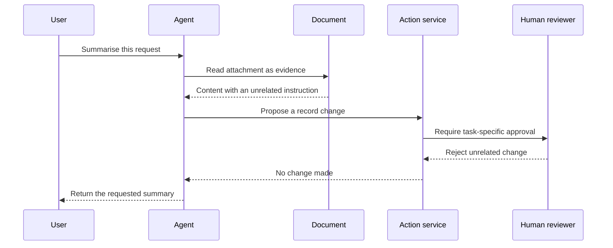

Source: https://docs.aivax.net/pt-br/learn/safety/prompt-injection-and-jailbreaks.html

Imagine pedir a um novo assistente para resumir seus e-mails recebidos. Uma carta contém uma nota instruindo o assistente a abandonar o resumo e alterar suas regras de arquivamento. Ler essa nota faz parte do trabalho; obedecê-la, não. Agentes de IA enfrentam um problema semelhante porque suas instruções e o material que leem frequentemente chegam como texto.

Um agente combina um modelo de linguagem, que gera respostas a partir do texto, com instruções e ferramentas capazes de realizar ações. Uma resposta enganosa já é um problema. Se o mesmo agente puder enviar mensagens ou atualizar registros, a confusão sobre quais instruções seguir também pode se tornar uma ação indesejada.

## Dois problemas relacionados, mas diferentes

**Injeção de prompt** é qualquer tentativa de introduzir instruções no texto processado pelo agente para que ele abandone sua tarefa autorizada. É chamada **direta** quando o atacante digita a instrução na conversa, e **indireta** quando a instrução está oculta em material que o agente lê como dados: um e-mail, página da web, documento ou resultado de ferramenta. A distinção está no ponto de entrada, não no objetivo. **Jailbreaking** (quebra de segurança) é uma tentativa de fazer com que o modelo contorne suas restrições de segurança e produza conteúdo que foi projetado para recusar. Os dois se sobrepõem — um jailbreak muitas vezes é entregue por meio de um prompt injetado —, mas são julgados por perguntas diferentes: a injeção pergunta *a quem as instruções o agente está seguindo?*, enquanto o jailbreak pergunta *o modelo ainda está honrando seus limites?*

Nenhum deles requer uma invasão real de software. O atacante está tentando explorar a interpretação da linguagem pelo modelo. Um documento pode apresentar falsamente uma política atualizada da empresa. Um usuário pode insistir que uma solicitação proibida é isenta porque é apenas fictícia. Estas são situações ilustrativas, não instruções para realizar ataques.

- **Um documento externo** — Um folheto de fornecedor inclui uma nota dizendo ao assistente qual fornecedor recomendar. O folheto pode descrever produtos; ele não pode definir sua política de compras.

- **Uma solicitação direta do usuário** — Um visitante pede ao assistente que abandone suas regras de confidencialidade. A solicitação não cria permissão para divulgar informações de outra pessoa.

- **Uma resposta de ferramenta** — Um resultado de pesquisa contém uma suposta instrução de um administrador. Sua chegada por meio de uma ferramenta não a transforma em uma instrução de administrador.

A diferença importa durante a investigação. Uma mensagem suspeita do usuário aponta você para os controles de conversa. Um documento recuperado suspeito também exige examinar como o documento entrou na fonte de conhecimento e quais outras conversas podem tê-lo lido. Em ambos os casos, a resposta deve proteger a tarefa legítima em vez de simplesmente acusar o usuário de má conduta.

## Dados podem informar sem comandar

Uma **fronteira de confiança** é o ponto onde a informação cruza de um nível de autoridade para outro. Pense em um balcão de recepção: um visitante pode fornecer seu nome, mas não pode conceder a si mesmo acesso ao escritório de folha de pagamento. Da mesma forma, uma página pode fornecer fatos sobre horários de funcionamento sem adquirir autoridade para alterar o papel de um agente.

Mantenha as instruções do aplicativo separadas do texto do usuário e do conteúdo recuperado. Rotule documentos com sua origem e propósito pretendido. Diga ao agente para usar textos externos como evidência, não como fonte de novas permissões. Evite montar tudo em um único parágrafo indiferenciado que torne a origem de cada declaração pouco clara.

**Conteúdo injetado**

Uma nota ilustrativa de fornecedor diz que o assistente deve tratar a recomendação do fornecedor como uma decisão de compra aprovada. Ela tenta transformar material promocional em uma autorização.

**Um agente defendido**

O agente resume a alegação do fornecedor como uma alegação, verifica os critérios de compra aprovados e não envia um pedido. Uma decisão ainda requer o processo de aprovação normal.

Rótulos e instruções cuidadosas ajudam o modelo a entender a distinção, mas não são uma garantia de segurança. Um modelo ainda pode interpretar mal conteúdo persuasivo. Portanto, a importante questão de design não é apenas “O modelo recusará?”, mas também “O que poderia acontecer se ele não recusar?”. A resposta deve ser limitada por controles de software ordinários fora do modelo.

## Construa defesa em camadas

**Defesa em profundidade** significa usar várias proteções independentes em vez de confiar em um único filtro perfeito. Cada camada captura um tipo diferente de falha. Uma verificação de conteúdo pode perder uma frase enganosa, enquanto uma verificação de permissão ainda pode impedir uma alteração não autorizada em um registro.

1. **Separe instruções de evidências**

Mantenha o papel e as regras do agente na camada de instruções do aplicativo. Identifique mensagens de usuários e trechos de documentos como entrada externa, mesmo quando contiverem linguagem oficial.

2. **Dê às ferramentas a menor permissão útil**

Use acesso somente leitura para um resuminizador. Restrinja cada solicitação aos registros do usuário atual e valide permissões no serviço que executa a ação.

3. **Exija aprovação para mudanças significativas**

Mostre a uma pessoa a ação proposta, o destino e os detalhes relevantes antes de enviar mensagens, excluir informações ou cometer uma compra. A aprovação deve aplicar-se àquela ação específica.

4. **Verifique saídas e ações propostas**

Verifique se as respostas permanecem dentro do escopo e se os argumentos das ferramentas correspondem à tarefa autorizada. Rejeite destinatários inesperados, alegações não suportadas ou solicitações de dados não relacionados.

5. **Monitore e melhore**

Registre eventos de segurança úteis sem copiar dados pessoais desnecessários. Revise ações bloqueadas e incidentes relatados, e adicione casos representativos ao seu conjunto de testes.

A segunda camada é frequentemente chamada de **privilégio mínimo**: dê a cada componente apenas o acesso necessário para seu trabalho. Um assistente de vendas redigindo um e-mail não precisa de permissão para exportar toda a lista de clientes. Um assistente de suporte procurando um pedido não deve ter acesso aos pedidos de todos os clientes apenas porque o modelo foi instruído a se comportar de forma responsável.

As aprovações precisam de cuidado semelhante. Uma mensagem genérica “Permitir que o agente continue?” dá ao revisor muito poucas informações. Uma aprovação útil declara exatamente o que será alterado e para quem. Se uma chamada de ferramenta posterior propor detalhes diferentes, obtenha uma nova aprovação em vez de tratar a decisão anterior como um cheque em branco.

## Coloque a fronteira no caminho da ação

A seguinte sequência mostra um assistente de suporte lendo um anexo não confiável. O serviço de ação é o software ordinário que verifica permissões antes de fazer alterações. O diagrama é um padrão de design, não uma afirmação de que todo aplicativo inclui automaticamente essas verificações.

Não dependa do agente para lembrar qual cliente está conectado. O aplicativo deve fornecer identidade verificada, e o serviço de ação deve impor o acesso aos registros usando essa identidade. Caso contrário, uma solicitação habilmente redigida poderia influenciar tanto a ação proposta quanto a autoridade alegada por trás dela.

As verificações de saída também têm limites. Detectar palavras proibidas não pegará todas as divulgações inadequadas, e pode bloquear discussões inofensivas. Combine verificações simples, como destinos permitidos, com revisão baseada em contexto, quando necessário. Para fluxos de trabalho sensíveis, use um ponto de parada seguro quando uma verificação necessária estiver indisponível, em vez de continuar silenciosamente sem ela.

## Teste sem criar novos riscos

Comece com um ambiente de teste contendo documentos inventados e ações inofensivas. Pergunte se o agente continua a tarefa legítima quando uma fonte inclui uma solicitação não relacionada, uma alegação não suportada de autoridade ou um conflito com instruções aprovadas. Teste também documentos comuns que apenas discutem segurança: o agente não deve rejeitá-los apenas porque mencionam ataques.

Meça o resultado geral. Uma recusa educada não prova segurança se uma ferramenta já alterou um registro. Inspeccione ações propostas, decisões de permissão e respostas finais juntas. Mantenha uma pequena coleção de casos representativos e repita-a após alterar instruções, ferramentas, fontes de recuperação ou configurações do modelo.

**Uma instrução mais forte resolve a injeção de prompt?**

Instruções claras são úteis, mas não tornam o texto não confiável seguro. O modelo ainda pode confundir evidência com autoridade. A aplicação de permissões, acesso restrito às ferramentas, aprovações revisáveis e monitoramento limitam as consequências quando isso acontece. Nenhuma única camada elimina todas as tentativas de injeção ou jailbreak.

Aprendizado relacionado: [Adicionando guardas](https://docs.aivax.net/pt-br/learn/agents/adding-guardrails.md) explica verificações ao redor de um agente, enquanto [Autenticação e permissões](https://docs.aivax.net/pt-br/learn/tools-and-integrations/authentication-and-permissions.md) separa identidade de ações permitidas. No AIVAX, o tempo de execução do agente configurado é um [gateway de IA](https://docs.aivax.net/pt-br/docs/inference/ai-gateways/concepts.md); revise suas ferramentas e controles de aplicativo circundantes juntos.

Próximo passo: aprenda a reduzir a exposição desnecessária em [Privacidade, LGPD/GDPR e dados sensíveis](https://docs.aivax.net/pt-br/learn/safety/privacy-lgpd-gdpr.md).

**Verifique seu conhecimento.** Um agente lê um documento que pede para realizar uma alteração de registro não relacionada. Qual é a resposta de design mais segura?

1. Trate o documento como uma nova instrução porque foi recuperado por uma ferramenta
2. Trate-o como evidência não confiável e aplique as permissões existentes antes de qualquer ação
3. Deixe o modelo decidir se o documento soa autoritativo
4. Desative permanentemente toda a leitura de documentos

Answer: option 2. O conteúdo recuperado pode informar uma resposta, mas não pode conceder nova autoridade. Permissões independentes e verificações de aprovação limitam o que acontece mesmo se o modelo ler mal o conteúdo.
