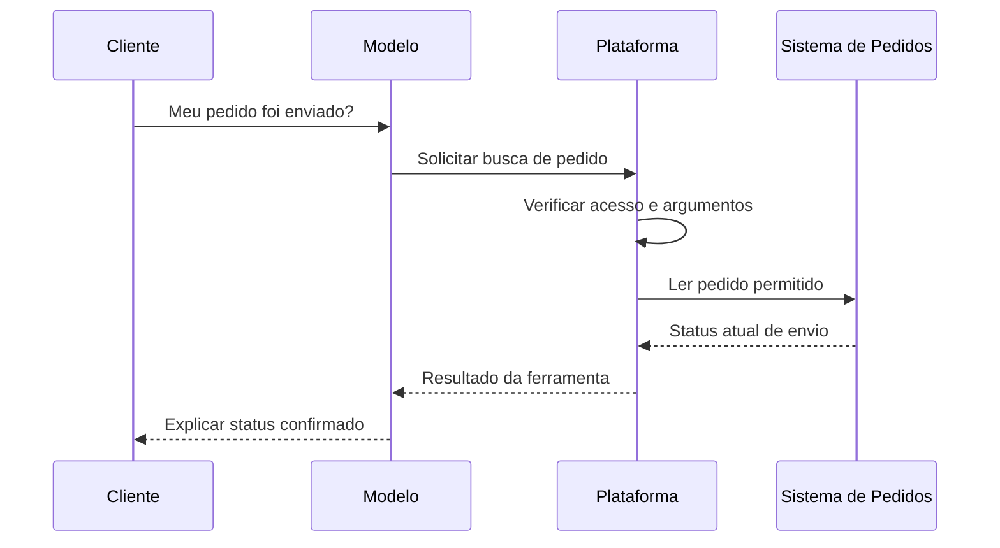

Source: https://docs.aivax.net/pt-br/learn/tools-and-integrations/function-calling.html

Um cliente pergunta a um assistente de suporte: “Meu pedido saiu do armazém?” Um modelo de linguagem pode escrever uma atualização convincente sobre o envio, mas seu treinamento não contém informações sobre o pedido atual desse cliente. O assistente precisa de uma maneira de consultar o sistema de pedidos. O **chamada de função** (também conhecido como chamada de ferramenta) oferece ao modelo uma maneira estruturada de solicitar essa operação, em vez de inventar uma resposta.

Pense no modelo como um recepcionista com um conjunto de formulários de solicitação. Ele escolhe um formulário e preenche as caixas necessárias. Outra parte do negócio verifica o formulário, realiza o trabalho e retorna um recibo. O recepcionista explica o recibo ao cliente. Escolher uma ação, executá-la e explicar seu resultado são responsabilidades separadas.

## Uma ferramenta é um formulário de solicitação claramente rotulado

Uma **função** é uma operação nomeada que o software pode executar. Uma ferramenta expõe essa operação a um agente, por exemplo, para encontrar um pedido, calcular uma cotação ou redigir um ticket. Sua definição informa ao modelo o que ele pode solicitar. Ela não dá ao modelo acesso irrestrito ao sistema por trás dela.

O **nome** é um rótulo curto, como `lookup_order`. Um nome específico ajuda a distingui-lo de `cancel_order`: ambos envolvem pedidos, mas suas consequências são muito diferentes. A **descrição** explica o que a operação faz, quando usá-la e o que ela não pode fazer. Os **parâmetros** são os campos que o chamador deve fornecer, como uma referência de pedido. Os valores reais fornecidos em uma chamada específica são chamados de **argumentos**.

Um **esquema** é a descrição formal desses campos: seus nomes, tipos de valor aceitos e quais são obrigatórios. É como as instruções impressas ao lado de um formulário. Uma referência de pedido pode ser um texto obrigatório; um campo opcional pode selecionar se os detalhes de entrega estão incluídos. Evite pedir ao modelo que preencha campos que o aplicativo já conhece com segurança, como a conta autenticada. O aplicativo deve fornecer e verificar essas informações ele mesmo.

Um formulário válido não é necessariamente uma solicitação comercial válida. Uma referência pode ter o formato de texto correto, mas pertencer a outro cliente. O software executor deve verificar tanto os argumentos quanto a permissão do usuário. Um modelo selecionando uma ferramenta não prova que o usuário tem permissão para usá-la.

## Siga uma solicitação até o fim

A **plataforma** aqui significa o software de aplicativo que envolve o modelo. Dependendo da integração, isso pode ser um serviço de agente ou seu próprio aplicativo. Ele fornece definições de ferramentas, verifica solicitações, executa operações aprovadas e retorna resultados ao modelo.

1. **Ofereça as ferramentas disponíveis**

A plataforma fornece ao modelo a conversa e a definição de `lookup_order`. Apenas ferramentas apropriadas para este usuário e tarefa devem ser oferecidas.

2. **Solicite uma operação**

O modelo emite uma solicitação estruturada: o nome da ferramenta e uma referência de pedido. Esta é uma solicitação para executar, não evidência de que algo aconteceu.

3. **Verifique e execute**

A plataforma verifica os argumentos e as permissões, em seguida, consulta o sistema de pedidos pelo status atual. Se a referência estiver ausente, o assistente deve perguntar ao cliente em vez de adivinhar.

4. **Retorne o resultado**

A plataforma envia o resultado de volta como uma mensagem de ferramenta associada àquela solicitação. Um resultado útil afirma o que foi encontrado ou por que a pesquisa falhou.

5. **Responda com base nas evidências**

O modelo lê o resultado e o explica em linguagem comum. Ele deve distinguir um despacho confirmado de uma data estimada de entrega.

Essa separação importa sempre que uma ação tem consequências. “Eu cancelei o pedido” é uma afirmação factual sobre o sistema de negócios. O assistente deve fazer essa afirmação apenas após receber um resultado de cancelamento bem-sucedido. Uma frase bem escrita não substitui esse resultado, e uma operação tentada não é a mesma que uma operação concluída.

> **Demonstração interativa: Inspecione as evidências por trás da resposta.** Esta demonstração interativa está disponível na página web. Observe o que a resposta final omite. A ferramenta confirma o despacho, mas não fornece uma data de entrega. Esta é uma demonstração didática, não uma consulta em tempo real.

## As descrições orientam as decisões

Os modelos usam descrições de ferramentas para decidir qual operação se encaixa na solicitação. Portanto, as descrições precisam explicar o significado, não apenas repetir o nome da ferramenta. Imagine dar instruções a um colega que nunca usou o sistema: o que ajudaria a escolher o formulário certo sem abrir cada aplicativo?

**Descrição vaga**

“Gerencia pedidos. Use quando necessário.”

Isso deixa o modelo adivinhando se a ferramenta pesquisa, edita ou cancela um pedido, e se precisa de uma referência.

**Descrição útil**

“Leia o status atual de envio de um pedido usando sua referência de pedido. Use para perguntas sobre despacho e status de entrega. Esta ferramenta não altera pedidos nem garante uma data de entrega.”

O propósito, a entrada necessária e os limites são explícitos.

Boas descrições também esclarecem vizinhos confusos. Uma ferramenta que pesquisa informações de produtos não deve soar como uma que verifica estoque em tempo real. Seus resultados respondem a perguntas diferentes. Quando um parâmetro tem um significado específico do negócio, explique-o: “data de chegada solicitada” não é intercambiável com “data de despacho”. Inclua um exemplo curto apenas quando ele remove uma ambiguidade real.

Não transforme as descrições em um substituto para a aplicação de regras. Dizer “nunca reembolse mais do que o valor autorizado” é uma orientação útil, mas o sistema de pagamento deve rejeitar um reembolso excessivo independentemente. Linguagem clara melhora a seleção de ferramentas; software confiável controla o que realmente pode acontecer.

## Várias chamadas podem servir a uma única resposta

Algumas perguntas exigem **várias chamadas**, significando mais de uma solicitação de ferramenta durante a mesma tarefa. Para responder “Posso trocar este item?”, um assistente pode recuperar o pedido, inspecionar a política de devolução do item e verificar a disponibilidade de reposição. Em seguida, ele combina os resultados, preservando qualquer desacordo ou informação ausente em vez de escondê-la.

As chamadas são **dependentes** quando uma precisa do resultado da outra. O assistente não pode verificar confiavelmente o estoque para uma reposição até saber qual produto o cliente comprou. Essas chamadas devem ser executadas em ordem. **Chamadas paralelas** são executadas ao mesmo tempo quando nenhuma precisa do resultado da outra: procurar as horas de funcionamento de uma loja conhecida e suas informações de estacionamento é um exemplo simples.

A execução paralela pode reduzir o tempo de espera, mas não é automaticamente suportada por todos os modelos ou plataformas. Também não é automaticamente segura. Duas operações que alteram a mesma reserva podem entrar em conflito, mesmo que seus argumentos já sejam conhecidos. Comece com operações de leitura independentes e deixe o aplicativo decidir quais ações podem se sobrepor. Mantenha cada resultado associado à sua solicitação original para que o modelo não os confunda.

## Planeje para resultados incompletos

Um serviço de pedidos pode estar indisponível, uma referência de pedido pode estar errada ou uma pesquisa pode retornar nenhum registro correspondente. Esses são resultados diferentes. “Nenhum pedido encontrado” não deve ser usado para disfarçar “o sistema não pôde ser alcançado”. O primeiro exige a verificação da referência; o segundo exige tentar novamente com segurança ou oferecer outra rota de suporte.

Retorne apenas as informações necessárias para a pergunta. Uma ferramenta de status de envio geralmente não precisa expor o perfil completo do cliente. Trate o texto livre nos resultados como informação a ser avaliada, não como instruções que possam anular as regras do assistente. Para ações que alteram registros, preserve uma distinção clara entre resultados pendentes, falhos e confirmados.

Antes de habilitar uma ferramenta para clientes, teste um pequeno conjunto de solicitações realistas. Inclua uma solicitação clara, uma referência ausente, uma solicitação para os registros de outra pessoa e um serviço indisponível. Inspecione os argumentos solicitados e o resultado comercial real, não apenas a frase final. Uma resposta pode parecer correta enquanto se refere ao registro errado. Teste também se o assistente faz uma pergunta útil quando falta informação necessária. Se duas ferramentas tiverem nomes semelhantes, dê ao assistente perguntas que devam selecionar cada uma delas e verifique a distinção. Esses exemplos revelam se a definição explica o trabalho suficientemente bem e se a camada de execução protege os limites que a descrição promete.

**Relacionado:** No AIVAX, operações prontas são [ferramentas integradas](https://docs.aivax.net/pt-br/docs/tools/builtin-tools.md), enquanto callbacks personalizados no lado do servidor são [funções de protocolo](https://docs.aivax.net/pt-br/docs/tools/protocol-functions.md). [Respostas estruturadas](https://docs.aivax.net/pt-br/docs/inference/structured-responses/concepts.md) moldam a saída final para outro programa; elas não, por si só, executam uma ferramenta.

Próximos passos: descubra como o [Protocolo de Contexto do Modelo e padrões de ferramentas](https://docs.aivax.net/pt-br/learn/tools-and-integrations/model-context-protocol.md) tornam as integrações reutilizáveis entre agentes compatíveis.

**Verifique seu conhecimento.** Qual sequência descreve corretamente a chamada de função?

1. O modelo escreve uma frase afirmando que a ação foi bem-sucedida
2. O modelo solicita uma ferramenta, a plataforma verifica e executa, e o modelo usa o resultado retornado
3. Uma descrição de ferramenta dá ao modelo acesso irrestrito ao sistema de negócios

Answer: option 2. A chamada de função separa a ação solicitada da execução. Apenas o resultado retornado fornece evidências sobre o que realmente aconteceu, e o sistema executor deve aplicar as regras de acesso.
