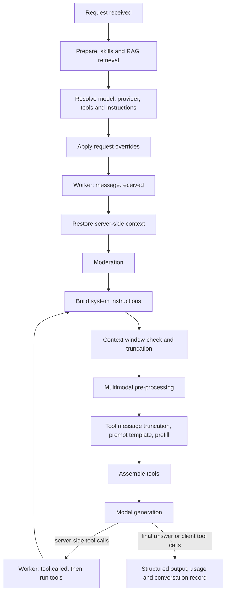

# Processing pipeline

When a request uses an [AI Gateway](/docs/inference/ai-gateways/concepts.md), AIVAX runs a fixed sequence of steps before, during, and after each model generation. Each step can add context, change the conversation, expose tools, or stop the request. Knowing the order helps you predict what each step can see: for example, moderation sees the documents retrieved by RAG, but not the descriptions produced by multimodal pre-processing.

Most steps are configured in the gateway parameters. Requests sent with a private key can override some of them; see [Inference with AI Gateways](ai-gateways.md).

## Order of execution

Steps 1 to 6 run once per request. Steps 7 to 12 form the agentic loop and run again every time the model calls a server-side tool.

| # | Step | Runs | What it does |
| --- | --- | --- | --- |
| 1 | [Prepare](#rag) | Once | Loads the gateway skills. For injection query strategies, searches the linked collections and inserts the results into the last user message. Collection contexts are added to the system instructions. |
| 2 | Resolve | Once | Resolves the model and provider through [routing](/docs/inference/routing/setup-routing.md), fetches [remote instruction sources](#instructions), loads protocol functions, protocol function sources, MCP tools, and gateway built-in tools, and applies the gateway [parameters](#parameterization). |
| 3 | Request overrides | Once | Applies request fields such as `temperature`, `tools`, `builtin_tools`, `multimodal_resolver`, and `response_format`. |
| 4 | [Worker `message.received`](/docs/inference/workers.md#messagereceived) | Once | Calls your worker, which can stop the request or change messages, instructions, tools, and MCP sources. |
| 5 | Server-side context | Once | Restores the [server-side context](server-side-context.md) of earlier turns when [session reuse](session-reuse.md) applies, and removes orphaned tool messages. |
| 6 | [Moderation](moderation.md) | Once | Evaluates the conversation text and blocks it, or adds self-assessment instructions and the refusal tool. |
| 7 | System instructions | Each iteration | Joins gateway instructions, remote sources, collection contexts, the `system` messages of the request, the skill list, and tool explanation guidance. |
| 8 | [Context truncation](context-truncation.md) | Each iteration | Compares the approximate input size with `contextMaximumSize` and applies `contextOverflowAction`. |
| 9 | [Multimodal pre-processing](multimodal-pre-processing.md) | Each iteration | Replaces media with textual descriptions using the configured engines. Results are cached, so media is described only once. |
| 10 | Message rewriting | Each iteration | Applies [tool message truncation](context-truncation.md#tool-message-truncation), the [user prompt template](#instructions), and, on the first iteration only, the [assistant prefill](#instructions). |
| 11 | Tool assembly | Each iteration | Joins request tools and server-side tools, removes identical duplicates, and rejects the request when two different tools share a name. With a [function interpreter](function-interpreter.md), tool selection happens here instead of in the provider call. |
| 12 | Generation and tools | Each iteration | Calls the provider. Server-side tool calls go through the [worker `tool.called` event](/docs/inference/workers.md#toolcalled), run inside AIVAX, and return to step 7 with their results. |
| 13 | Finalization | Once | Validates or heals [structured output](structured-output.md), records usage and cost, and stores the conversation when logging is enabled. |

### What the order means in practice

- **Workers run before moderation.** A worker can block a request without spending moderation, and moderation evaluates the conversation after the worker changed it.
- **Moderation sees retrieved documents.** RAG results are inserted into the last user message before moderation runs, so the safeguard evaluates them together with the user's text.
- **Moderation does not see media.** Multimodal pre-processing runs after moderation, so media descriptions are not moderated.
- **Moderation runs once per request.** Tool results produced during the agentic loop are not moderated.
- **Truncation can happen in the middle of a request.** The context check runs on every iteration, so large tool results can cause older messages to be removed, or a `Throw` error, after some tools already ran.
- **The context size is measured before pre-processing.** Media is counted by its original size estimate, not by the size of its textual description.
- **The prompt template applies to every user message,** including messages that carry retrieved RAG documents.

## RAG

The RAG step adds knowledge from your documents to the model context. It links [collections](/docs/rag/collections) to an AI Gateway. The gateway controls:

- Collections included in retrieval.
- Maximum number of retrieved documents.
- Minimum score.
- Reranker name.
- Whether chunk references are included.
- Query strategy.

When a gateway has knowledge collections and the latest user message contains text, AIVAX can retrieve matching documents before the model call. For injection strategies, the retrieved context is inserted at the beginning of the last user message. If a linked collection has its own context text, that collection context is added to system instructions.

Query strategies:

- `Plain`: Uses the latest user message as the search query.
- `Concatenate`: Joins the latest configured number of user messages line by line and searches with the combined text.
- `UserRewrite`: Rewrites recent user messages into one or more search queries using a resolver model.
- `FullRewrite`: Rewrites recent user and assistant messages into one or more search queries using a resolver model.
- `QueryFunction`: Adds a query function to the model. The model decides when to search the linked collections, and search results are returned as tool responses. The model can narrow a search with an optional [document filter](/docs/rag/document-filters).

Rewrite strategies add resolver-model cost (see [Pricing](/docs/pricing)) and latency. They are useful when follow-up questions depend on earlier turns.

Defining many RAG results increases input token usage and can increase final inference cost (see [Pricing](/docs/pricing)). Start with a small result count and raise it only when the model lacks enough evidence.

## Instructions

Instruction settings shape the provider-facing prompt:

- **System instructions**: Added to the system instruction set.
- **Remote system instruction sources**: Fetched from configured URLs and added to the system instruction set.
- **User prompt template**: Replaces `{prompt}` with each user message's text before sending it to the model. The templated message is sent as text only, so media attached to user messages is not sent to the model when a template is set.
- **Assistant prefill**: Adds initial assistant content before generation when the model supports prefill.

Remote instruction sources are fetched as text, and each response can be at most 5 MB. Their cache duration is configurable from 0 (no caching) to 86,400 seconds; the default is 600 seconds.

If a source cannot be read (response over the limit, failed request, or unsafe URL), it contributes no text and the request itself does not fail. Keep these failure rules in mind:

- A failed fetch (an HTTP error such as 404 or 500, a connection error, a private URL, or a response over the limit) contributes no text and is cached for at most 30 seconds, or for the configured duration when it is shorter.
- There is no stale-if-error fallback. If a previously good source expires during an outage, the model receives only the `# <name>` title with no body (or nothing, if the source has no name).
- No error or log entry is shown when this happens.

Some models do not support assistant prefill, temperature, stop sequences, or reasoning effort. Integrated model validation rejects incompatible gateway settings when those limitations are known.

## Skills

Skills are on-demand instruction packs available to the model. Use them for specialized instructions that only some tasks need. When a gateway enables skills, AIVAX loads the account skills configured on the gateway and can expose skill-related built-in functions.

Read more about [skills](/docs/inference/skills).

## Multimodal pre-processing

Multimodal pre-processing converts selected media content into text before the main model call. Each content type (images, audio, video, and files) uses its own engine: a smaller (`InferenceLow`) or larger (`InferenceHigh`) multimodal model, OCR for images and files, or speech-to-text for audio. See [Multimodal pre-processing](multimodal-pre-processing.md) for the accepted engines.

The gateway setting `multimodalResolverParameters` replaces the deprecated `enabledMultimodalFeatures` flags. Gateways that still use the flags keep working with the equivalent engines until `multimodalResolverParameters` is set.

Use pre-processing when the main model is text-first or when you want AIVAX to normalize media into textual context. For direct multimodal models, send the original media without pre-processing so the model can inspect it directly.

Results are cached by content and engine for reuse.

## Parameterization

The gateway sets default model request options, such as:

- `temperature`
- `top_p`
- `presence_penalty`
- `frequency_penalty`
- `stop`
- `max_completion_tokens`
- `reasoning_effort`
- `verbosity`

Request-level values can override gateway values when the endpoint supports the parameter. `seed` is accepted only per request. `frequency_penalty` is configured only on the gateway and is not overridden per request. Some integrated models reject specific parameters, and BYOK providers may have their own restrictions.

## Context truncation

`contextMaximumSize`, `contextOverflowAction`, and `toolContextCount` keep long conversations within a maximum input size. See [Context truncation](context-truncation.md).

## Moderation

Input moderation blocks unsafe or out-of-policy requests before the main model answers them. See [Moderation](moderation.md).

## Server-side tools

Server-side tools are internal functions executed by AIVAX during inference. They can come from:

- Built-in tools.
- Protocol functions.
- Remote protocol function sources.
- MCP sources.
- QueryFunction RAG.
- Skills.
- Optional bash environment.

Server-side tool events can be streamed to clients as `servertool` updates.

## Built-in tools

Built-in tools can be configured on a gateway or supplied per request with `builtin_tools`. Available built-in tool flags include:

- `DateTime` — current date and time through `get_date_time`, in the gateway time zone (`parameters.timeZone`, default `America/Sao_Paulo`).
- `WebSearch`
- `AdvancedWebUsage` (disabled; returns an unavailable response. See [Changelogs](/docs/legal/changelogs.md).)
- `OpenUrl`
- `Code`
- `Request`
- `Remember`
- `GenerateWebPage`
- `GenerateDocument`
- `XPostsSearch`
- `ImageGeneration`

See [Built-in tools](/docs/tools/builtin-tools).

## MCP and protocol functions

Tools listed by an MCP source become available to the model with their declared schemas. MCP tool results can include text, images, and audio; media results are attached to the conversation as additional messages when supported.

Protocol functions expose HTTP callbacks or AIVAX callback URLs as model-callable tools. Remote protocol function sources are fetched and cached before their tools become available to the model.

See [Protocol functions](/docs/tools/protocol-functions) and [MCP](/docs/tools/mcp).

## Function interpreter

The function interpreter is deprecated. See [Function interpreter](function-interpreter.md).

## Workers

Workers call your external endpoint during gateway events, so your own code can allow, stop, or change the request. Configure worker events and endpoint details in the gateway parameters, and implement the event behavior at your endpoint. See [AI Workers](/docs/inference/workers).
