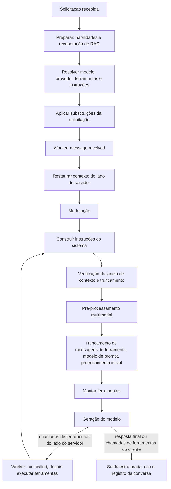

# Pipeline de processamento

Quando uma solicitação utiliza um [AI Gateway](/docs/pt-br/inference/ai-gateways/concepts.md), o AIVAX executa uma sequência fixa de etapas antes, durante e após a geração de cada modelo. Cada etapa pode adicionar contexto, alterar a conversa, expor ferramentas ou interromper a solicitação. Conhecer a ordem ajuda a prever o que cada etapa pode ver: por exemplo, a moderação vê os documentos recuperados pelo RAG, mas não as descrições produzidas pelo pré-processamento multimodal.

A maioria das etapas é configurada nos parâmetros do gateway. Solicitações enviadas com uma chave privada podem substituir algumas delas; consulte [Inferência com AI Gateways](ai-gateways.md).

## Ordem de execução

As etapas 1 a 6 são executadas uma vez por solicitação. As etapas 7 a 12 formam o loop agêntico e são executadas novamente sempre que o modelo chama uma ferramenta do lado do servidor.

| # | Etapa | Executa | O que faz |
| --- | --- | --- | --- |
| 1 | [Preparar](#rag) | Uma vez | Carrega as habilidades do gateway. Para estratégias de injeção de consulta, pesquisa nas coleções vinculadas e insere os resultados na última mensagem do usuário. Os contextos das coleções são adicionados às instruções do sistema. |
| 2 | Resolver | Uma vez | Resolve o modelo e o provedor através do [roteamento](/docs/pt-br/inference/routing/setup-routing.md), busca [fontes de instrução remotas](#instructions), carrega funções de protocolo, fontes de funções de protocolo, ferramentas MCP e ferramentas integradas do gateway, e aplica os [parâmetros](#parameterization) do gateway. |
| 3 | Substituições da solicitação | Uma vez | Aplica campos da solicitação como `temperature`, `tools`, `builtin_tools`, `multimodal_resolver` e `response_format`. |
| 4 | [Worker `message.received`](/docs/pt-br/inference/workers.md#messagereceived) | Uma vez | Chama seu worker, que pode interromper a solicitação ou alterar mensagens, instruções, ferramentas e fontes MCP. |
| 5 | Contexto do lado do servidor | Uma vez | Restaura o [contexto do lado do servidor](server-side-context.md) das rodadas anteriores quando a [reutilização de sessão](session-reuse.md) se aplica e remove mensagens de ferramentas órfãs. |
| 6 | [Moderação](moderation.md) | Uma vez | Avalia o texto da conversa e a bloqueia, ou adiciona instruções de autoavaliação e a ferramenta de recusa. |
| 7 | Instruções do sistema | Cada iteração | Junta instruções do gateway, fontes remotas, contextos de coleção, mensagens `system` da solicitação, lista de habilidades e diretrizes de explicação de ferramentas. |
| 8 | [Truncamento de contexto](context-truncation.md) | Cada iteração | Compara o tamanho aproximado de entrada com `contextMaximumSize` e aplica `contextOverflowAction`. |
| 9 | [Pré-processamento multimodal](multimodal-pre-processing.md) | Cada iteração | Substitui mídia por descrições textuais usando os mecanismos configurados. Os resultados são armazenados em cache, então a mídia é descrita apenas uma vez. |
| 10 | Reescrita de mensagens | Cada iteração | Aplica [truncamento de mensagens de ferramenta](context-truncation.md#tool-message-truncation), o [modelo de prompt do usuário](#instructions) e, apenas na primeira iteração, o [preenchimento inicial do assistente](#instructions). |
| 11 | Montagem de ferramentas | Cada iteração | Junta ferramentas da solicitação e ferramentas do lado do servidor, remove duplicatas idênticas e rejeita a solicitação quando duas ferramentas diferentes compartilham o mesmo nome. Com um [interpretador de função](function-interpreter.md), a seleção de ferramentas ocorre aqui em vez de na chamada do provedor. |
| 12 | Geração e ferramentas | Cada iteração | Chama o provedor. Chamadas de ferramentas do lado do servidor passam pelo [evento `tool.called` do worker](/docs/pt-br/inference/workers.md#toolcalled), são executadas dentro do AIVAX e retornam à etapa 7 com seus resultados. |
| 13 | Finalização | Uma vez | Valida ou corrige [saída estruturada](structured-output.md), registra uso e custo, e armazena a conversa quando o log está habilitado. |

### O que a ordem significa na prática

- **Workers são executados antes da moderação.** Um worker pode bloquear uma solicitação sem gastar recursos de moderação, e a moderação avalia a conversa após o worker alterá-la.
- **A moderação vê documentos recuperados.** Os resultados do RAG são inseridos na última mensagem do usuário antes que a moderação seja executada, para que a salvaguarda os avalie junto com o texto do usuário.
- **A moderação não vê mídia.** O pré-processamento multimodal é executado após a moderação, portanto, as descrições de mídia não são moderadas.
- **A moderação é executada uma vez por solicitação.** Resultados de ferramentas produzidos durante o loop agêntico não são moderados.
- **O truncamento pode acontecer no meio de uma solicitação.** A verificação de contexto é executada em cada iteração, então grandes resultados de ferramentas podem causar a remoção de mensagens mais antigas ou um erro `Throw`, após algumas ferramentas já terem sido executadas.
- **O tamanho do contexto é medido antes do pré-processamento.** A mídia é contada por sua estimativa de tamanho original, não pelo tamanho de sua descrição textual.
- **O modelo de prompt se aplica a cada mensagem do usuário,** incluindo mensagens que carregam documentos RAG recuperados.

## RAG

A etapa de RAG adiciona conhecimento dos seus documentos ao contexto do modelo. Ela vincula [coleções](/docs/pt-br/rag/collections) a um AI Gateway. O gateway controla:

- Coleções incluídas na recuperação.
- Número máximo de documentos recuperados.
- Pontuação mínima.
- Nome do reranker.
- Se referências de chunk estão incluídas.
- Estratégia de consulta.

Quando um gateway possui coleções de conhecimento e a última mensagem do usuário contém texto, o AIVAX pode recuperar documentos correspondentes antes da chamada do modelo. Para estratégias de injeção, o contexto recuperado é inserido no início da última mensagem do usuário. Se uma coleção vinculada tiver seu próprio texto de contexto, esse contexto da coleção será adicionado às instruções do sistema.

Estratégias de consulta:

- `Plain`: Usa a última mensagem do usuário como a consulta de pesquisa.
- `Concatenate`: Junta as últimas mensagens configuradas do usuário linha por linha e pesquisa com o texto combinado.
- `UserRewrite`: Reescreve mensagens recentes do usuário em uma ou mais consultas de pesquisa usando um modelo de resolução.
- `FullRewrite`: Reescreve mensagens recentes do usuário e do assistente em uma ou mais consultas de pesquisa usando um modelo de resolução.
- `QueryFunction`: Adiciona uma função de consulta ao modelo. O modelo decide quando pesquisar nas coleções vinculadas, e os resultados da pesquisa são retornados como respostas de ferramenta. O modelo pode restringir uma pesquisa com um [filtro de documento](/docs/pt-br/rag/document-filters) opcional.

Estratégias de reescrita adicionam custo (consulte [Preços](/docs/pt-br/pricing)) e latência do modelo de resolução. Elas são úteis quando perguntas de acompanhamento dependem de rodadas anteriores.

Definir muitos resultados de RAG aumenta o uso de tokens de entrada e pode aumentar o custo final de inferência (consulte [Preços](/docs/pt-br/pricing)). Comece com uma pequena contagem de resultados e aumente-a apenas quando o modelo não tiver evidências suficientes.

## Instruções

As configurações de instrução moldam o prompt voltado para o provedor:

- **Instruções do sistema**: Adicionadas ao conjunto de instruções do sistema.
- **Fontes de instrução do sistema remotas**: Buscadas de URLs configuradas e adicionadas ao conjunto de instruções do sistema.
- **Modelo de prompt do usuário**: Substitui `{prompt}` pelo texto de cada mensagem do usuário antes de enviá-lo ao modelo. A mensagem modelada é enviada apenas como texto, então a mídia anexada às mensagens do usuário não é enviada ao modelo quando um modelo está definido.
- **Preenchimento inicial do assistente**: Adiciona conteúdo inicial do assistente antes da geração quando o modelo suporta preenchimento inicial.

Fontes de instrução remotas são buscadas como texto, e cada resposta pode ter no máximo 5 MB. Sua duração de cache é configurável de 0 (sem cache) a 86.400 segundos; o padrão é 600 segundos.

Se uma fonte não puder ser lida (resposta acima do limite, falha na solicitação ou URL insegura), ela não contribui com texto e a própria solicitação não falha. Tenha essas regras de falha em mente:

- Uma falha na busca (um erro HTTP como 404 ou 500, um erro de conexão, uma URL privada ou uma resposta acima do limite) não contribui com texto e é armazenada em cache por no máximo 30 segundos, ou pela duração configurada quando esta for menor.
- Não há fallback stale-if-error. Se uma fonte anteriormente boa expirar durante uma interrupção, o modelo receberá apenas o título `# <nome>` sem corpo (ou nada, se a fonte não tiver nome).
- Nenhuma mensagem de erro ou entrada de log é exibida quando isso acontece.

Alguns modelos não suportam preenchimento inicial do assistente, temperatura, sequências de parada ou esforço de raciocínio. A validação integrada do modelo rejeita configurações incompatíveis do gateway quando essas limitações são conhecidas.

## Habilidades

Habilidades são pacotes de instrução sob demanda disponíveis para o modelo. Use-as para instruções especializadas que apenas algumas tarefas precisam. Quando um gateway habilita habilidades, o AIVAX carrega as habilidades da conta configuradas no gateway e pode expor funções integradas relacionadas às habilidades.

Leia mais sobre [habilidades](/docs/pt-br/inference/skills).

## Pré-processamento multimodal

O pré-processamento multimodal converte conteúdo de mídia selecionado em texto antes da chamada principal do modelo. Cada tipo de conteúdo (imagens, áudio, vídeo e arquivos) usa seu próprio mecanismo: um modelo multimodal menor (`InferenceLow`) ou maior (`InferenceHigh`), OCR para imagens e arquivos, ou fala para texto para áudio. Consulte [Pré-processamento multimodal](multimodal-pre-processing.md) para os mecanismos aceitos.

A configuração do gateway `multimodalResolverParameters` substitui as sinalizações `enabledMultimodalFeatures` obsoletas. Gateways que ainda usam as sinalizações continuam funcionando com os mecanismos equivalentes até que `multimodalResolverParameters` seja definido.

Use o pré-processamento quando o modelo principal for baseado em texto ou quando você quiser que o AIVAX normalize a mídia em contexto textual. Para modelos multimodais diretos, envie a mídia original sem pré-processamento para que o modelo possa inspecioná-la diretamente.

Os resultados são armazenados em cache por conteúdo e mecanismo para reutilização.

## Parametrização

O gateway define opções padrão de solicitação do modelo, como:

- `temperature`
- `top_p`
- `presence_penalty`
- `frequency_penalty`
- `stop`
- `max_completion_tokens`
- `reasoning_effort`
- `verbosity`

Valores em nível de solicitação podem substituir valores do gateway quando o endpoint suporta o parâmetro. `seed` é aceito apenas por solicitação. `frequency_penalty` é configurado apenas no gateway e não é substituído por solicitação. Alguns modelos integrados rejeitam parâmetros específicos, e provedores BYOK podem ter suas próprias restrições.

## Truncamento de contexto

`contextMaximumSize`, `contextOverflowAction` e `toolContextCount` mantêm conversas longas dentro de um tamanho máximo de entrada. Consulte [Truncamento de contexto](context-truncation.md).

## Moderação

A moderação de entrada bloqueia solicitações inseguras ou fora da política antes que o modelo principal as responda. Consulte [Moderação](moderation.md).

## Ferramentas do lado do servidor

Ferramentas do lado do servidor são funções internas executadas pelo AIVAX durante a inferência. Elas podem vir de:

- Ferramentas integradas.
- Funções de protocolo.
- Fontes remotas de funções de protocolo.
- Fontes MCP.
- RAG QueryFunction.
- Habilidades.
- Ambiente bash opcional.

Eventos de ferramentas do lado do servidor podem ser transmitidos para clientes como atualizações `servertool`.

## Ferramentas integradas

Ferramentas integradas podem ser configuradas em um gateway ou fornecidas por solicitação com `builtin_tools`. As sinalizações de ferramentas integradas disponíveis incluem:

- `DateTime` — data e hora atuais através de `get_date_time`, no fuso horário do gateway (`parameters.timeZone`, padrão `America/Sao_Paulo`).
- `WebSearch`
- `AdvancedWebUsage` (desabilitado; retorna uma resposta indisponível. Consulte [Registros de alterações](/docs/pt-br/legal/changelogs.md).)
- `OpenUrl`
- `Code`
- `Request`
- `Remember`
- `GenerateWebPage`
- `GenerateDocument`
- `XPostsSearch`
- `ImageGeneration`

Consulte [Ferramentas integradas](/docs/pt-br/tools/builtin-tools).

## MCP e funções de protocolo

Ferramentas listadas por uma fonte MCP ficam disponíveis para o modelo com seus esquemas declarados. Resultados de ferramentas MCP podem incluir texto, imagens e áudio; resultados de mídia são anexados à conversa como mensagens adicionais quando suportados.

Consulte [Funções de protocolo](/docs/pt-br/tools/protocol-functions) e [MCP](/docs/pt-br/tools/mcp).

## Interpretador de função

O interpretador de função está obsoleto. Consulte [Interpretador de função](function-interpreter.md).

## Workers

Workers chamam seu endpoint externo durante eventos do gateway, para que seu próprio código possa permitir, interromper ou alterar a solicitação. Configure eventos de worker e detalhes do endpoint nos parâmetros do gateway e implemente o comportamento do evento no seu endpoint. Consulte [AI Workers](/docs/pt-br/inference/workers).
