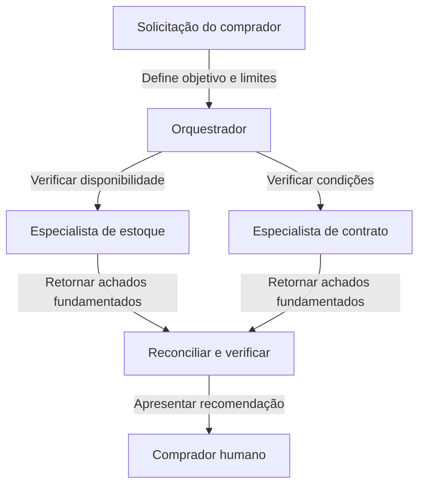

Uma empresa não contrata um funcionário separado para cada frase de um relatório. Ela divide o trabalho onde diferentes especialidades, acesso ou responsabilidades justificam a transferência. O mesmo princípio se aplica aos agentes de IA. Vários agentes podem ajudar com uma tarefa complicada, mas seu número não é uma medida de qualidade. A coordenação adiciona trabalho por si só, e alguém deve permanecer responsável pelo resultado.

Uma **arquitetura multi-agente** é um design no qual mais de um agente configurado contribui para uma tarefa. **Orquestração** significa organizar seu trabalho: decidir quem recebe qual atribuição, em que ordem, com quais informações e quem verifica o resultado. Esses arranjos podem ser implementados parcialmente com regras de software comuns. Um modelo de IA não precisa tomar todas as decisões de agendamento.

## Comece com um agente capaz

Antes de dividir uma tarefa, dê a um único agente um objetivo claro, informações relevantes e um conjunto limitado de ferramentas úteis. Um assistente de suporte que consulta um pedido, lê a política de devoluções e explica o próximo passo pode não precisar de três agentes separados. Essas ações muitas vezes compartilham o mesmo contexto e seguem uma sequência simples.

Adicionar especialistas torna-se útil quando existe uma fronteira real. Um revisor de contratos e um analista de ações precisam de fontes diferentes e critérios de avaliação distintos. O acesso separado também pode importar: o agente que verifica informações públicas de fornecedores não precisa ter acesso a registros privados de clientes. A separação reduz a exposição acidental apenas quando as permissões são aplicadas pelo aplicativo, não meramente descritas em prompts de papéis diferentes.



Um proprietário mantém a conversa e as evidências relevantes juntas. Isso é mais simples de inspecionar e frequentemente evita repetição de contexto. Escolha-o quando a tarefa se encaixa em um papel e um conjunto gerenciável de ferramentas.


Trabalhadores distintos podem investigar perguntas independentes ou aplicar verificações diferentes. Isso adiciona custos de transferências, gerenciamento de estado compartilhado e revisão. Escolha-o quando essas fronteiras resolvem um problema demonstrado.



A comparação justa é a mesma tarefa, julgada contra os mesmos critérios de aceitação. Não compare um sistema multi-agente cuidadosamente projetado com um único agente deliberadamente subequipado. Verifique a qualidade das evidências, o tempo de conclusão, o gasto total e com que frequência uma pessoa precisa reparar o resultado. Um design mais elaborado deve justificar sua complexidade através de melhorias observadas.

## Quatro padrões úteis

Um **padrão** é um arranjo recorrente que você pode adaptar, em vez de um produto que você deve comprar. Esses padrões podem coexistir, mas combiná-los todos de uma vez geralmente torna uma primeira implementação mais difícil de entender. Comece com o menor arranjo que corresponda à forma como o trabalho realmente depende dos resultados anteriores.



Um coordenador atribui partes delimitadas, coleta evidências e produz o resultado final. Os especialistas retornam achados, em vez de decidir independentemente o que dizer ao cliente.


Uma primeira etapa identifica o tipo de solicitação e a direciona para o agente apropriado. A maioria das solicitações segue uma rota em vez de consultar todos os especialistas.


O trabalho passa por etapas ordenadas, como extrair, verificar e rascunhar. Cada etapa tem uma entrada e saída definidas que a próxima etapa pode usar.


Um trabalhador propõe uma resposta e outro a desafia com base em evidências ou critérios explícitos. O revisor deve ter permissão para concluir que não há suporte para nenhuma conclusão.



Um **orquestrador** é como um coordenador de projeto, não um gerente com discricionariedade ilimitada. Para um briefing de compras, ele pode pedir a um especialista para comparar a disponibilidade e a outro para verificar as condições do contrato. Em seguida, reconcilia os achados em uma recomendação. Os especialistas podem trabalhar ao mesmo tempo apenas se nenhum deles precisar do resultado inacabado do outro. Trabalho paralelo significa trabalho simultâneo; não é automaticamente trabalho independente.

Um **roteador**, também chamado de etapa de triagem, assemelha-se a um balcão de recepção. Ele envia uma pergunta sobre entrega para o suporte e uma solicitação de cotação para as vendas. O roteamento deve ter um caminho para solicitações ambíguas. Se um cliente combina uma reclamação com uma pergunta de compra, pedir esclarecimentos pode ser melhor do que passar repetidamente a conversa entre agentes.

Um **pipeline** assemelha-se a uma linha de montagem. A etapa de extração transforma um documento em campos, a etapa de verificação identifica informações ausentes e a etapa de redação cria uma resposta. Uma extração falha não deve ser disfarçada como um registro vazio, mas válido. Cada transferência precisa de um status claro de sucesso ou falha para que as etapas posteriores não construam confiantemente sobre fatos ausentes.

Um **crítico** verifica uma proposta, em vez de meramente reescrever seu tom. Dê-lhe critérios, como “todo total citado deve incluir entrega” e acesso às evidências. Dois agentes concordando não estabelece verdade: eles podem usar a mesma fonte equivocada ou repetir a mesma suposição sem suporte. O debate é útil apenas quando o desacordo pode ser resolvido através de melhores evidências ou de uma decisão humana.



Use isso quando investigações distintas contribuem para uma decisão, como comparar estoque e termos contratuais. Decida quem reconcilia achados conflitantes antes de criar as atribuições dos especialistas.


Use isso quando as solicitações pertencem a áreas de serviço diferentes, como suporte e vendas. Defina o que acontece quando a categoria é incerta ou uma solicitação abrange ambas as áreas.


Use isso quando o trabalho posterior requer um resultado anterior verificado, como redigir uma resposta a partir de detalhes de fatura extraídos. Especifique o que cada etapa deve fornecer antes que a próxima etapa possa continuar.


Use isso quando uma proposta precisa de um desafio baseado em evidências separado. Identifique as verificações independentes que o revisor pode realizar e quem resolve um desacordo que as evidências não estabelecem.



## Compartilhe um registro de trabalho, não toda a conversa

**Estado compartilhado** é o registro atual da tarefa disponível para os trabalhadores que precisam dele. Pense em uma pasta de projeto compartilhada contendo o objetivo, fatos aceitos, fontes, perguntas pendentes e progresso. Deve distinguir uma observação de uma interpretação proposta. “O catálogo diz disponível” e “a entrega cumprirá o prazo” não são declarações intercambiáveis.

Uma transferência útil inclui a pergunta atribuída, escopo, referências de fonte, achado, incerteza e status de conclusão. Não requer despejar toda a conversa em cada agente. Informações excessivas aumentam o custo e podem expor dados desnecessariamente. Dê a um trabalhador contexto suficiente para fazer seu trabalho e nenhuma autoridade adicional apenas porque outro trabalhador tem acesso mais amplo.

Decida quem pode atualizar cada parte do registro. Se o agente de estoque e o agente de contrato sobrescreverem ambos a recomendação final, o resultado pode depender de quem termina por último. Um arranjo mais simples permite que os especialistas anexem achados e reserva a decisão final para o coordenador. Preserve as evidências anteriores quando uma conclusão mudar, para que um revisor possa entender a correção.

As regras de transferência são tão importantes quanto as descrições de função. Veja [Comunicação entre agentes](../agents/agent-to-agent-communication.md) para saber como solicitações e resultados cruzam os limites dos agentes. Uma mensagem dizendo “concluído” deve referir-se a um entregável observável, não meramente indicar que o trabalhador parou de gerar texto.

## Evite que a coordenação se torne a tarefa

Uma falha comum é um loop de delegação: o agente A pede ao agente B, que devolve o mesmo problema ao A. Outra é a investigação duplicada, onde vários trabalhadores pesquisam as mesmas fontes sem adicionar uma verificação distinta. Use atribuições explícitas, um registro de trabalho concluído e um limite na profundidade da delegação. O coordenador deve parar quando nenhuma nova evidência estiver sendo produzida.

Respostas inconsistentes exigem uma regra de reconciliação. Se um agente relatar estoque disponível e outro relatar indisponível, compare datas de fonte, variantes de produto e se algum resultado foi armazenado em cache, ou seja, reutilizado de uma consulta anterior. Não faça média de dois fatos incompatíveis. Se o conflito não puder ser resolvido dentro do orçamento permitido, apresente-o como não resolvido e identifique a decisão que ele bloqueia.

O custo também se espalha pelo sistema. Cada especialista pode ler instruções repetidas, chamar ferramentas, tentar novamente falhas e retornar um relatório longo. Trabalhar em paralelo pode reduzir o tempo de espera enquanto ainda aumenta o gasto total. Aplique um orçamento geral de tarefa, bem como limites por trabalhador. Caso contrário, um coordenador pode parecer econômico enquanto seu trabalho delegado consome os recursos.

Finalmente, nomeie um proprietário para ações externas e um proprietário para a resposta final. Trabalhadores independentes não devem enviar mensagens ao cliente ou modificar o mesmo registro. O proprietário verifica as evidências e verifica as permissões antes de agir. Isso mantém um design multi-agente compreensível: muitos colaboradores podem investigar, mas a responsabilidade por um resultado consequente permanece explícita.

**Relacionado:** No AIVAX, um [gateway de IA](../../docs/inference/ai-gateways/concepts.md) armazena uma configuração de agente reutilizável. Configurações separadas podem suportar papéis distintos, mas criar vários gateways não fornece por si só estado compartilhado, agendamento ou um design completo de orquestração.

Próximo passo: decida quando esse proprietário deve pausar para uma pessoa em [Humano no loop e aprovações](human-in-the-loop.md).

{{< quiz options="Adicione mais agentes até que suas respostas concordem | Deixe cada especialista enviar sua própria recomendação diretamente ao cliente | Use atribuições claras de especialistas, preserve evidências e faça um coordenador reconciliar o resultado | Dê a cada agente acesso a todos os sistemas para que as transferências sejam desnecessárias" answer="3" explanation="Atribuições explícitas e um único coordenador responsável reduzem a duplicação e resultados conflitantes. O acordo por si só não é evidência, e mais acesso não substitui um contrato de transferência." >}}
Qual design mantém melhor a responsabilidade em uma revisão multi-agente de fornecedores?

