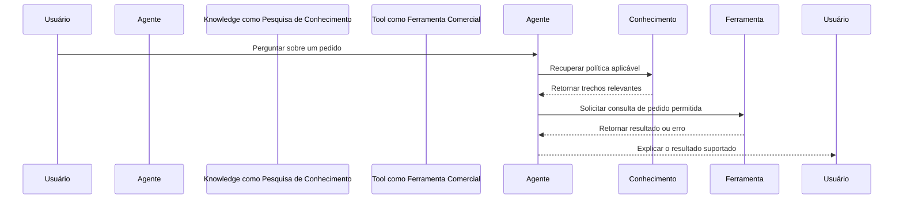

Um cliente relata que um agente prometeu atualizar o endereço de entrega, mas nada mudou. Ler a resposta final revela o que o agente disse. Isso não informa se o agente verificou as permissões, entrou em contato com o sistema de pedidos ou recebeu um erro. **Monitoramento** significa observar o comportamento do sistema ao longo do tempo para que esses problemas possam ser detectados e investigados, em vez de permanecerem como reclamações isoladas.

Pense em um restaurante. O cliente vê uma refeição chegar, mas o restaurante precisa saber quando o pedido foi feito, quando a cozinha o recebeu e se um ingrediente estava indisponível. Um agente também tem várias etapas entre a solicitação e o resultado. O monitoramento útil conecta essas etapas sem transformar o caderno do restaurante em uma cópia desnecessária da vida privada de cada cliente.

## Uma linha de registro registra um evento; um rastreamento conecta a jornada

Um **registro** (log) é um registro de eventos. Uma única **linha de registro**, ou registro de evento, pode indicar que uma pesquisa de documentos foi concluída, uma ferramenta falhou ou uma resposta foi entregue. Bons registros indicam quando algo aconteceu, qual etapa o produziu e se foi bem-sucedido. Uma ferramenta é uma função conectada que o agente pode solicitar, como uma consulta de pedido. "Chamada de ferramenta concluída" precisa ter um significado claro: receber uma resposta não necessariamente significa concluir a ação comercial.

Um **rastreamento** (trace) agrupa eventos relacionados e tempos para uma única solicitação, permitindo seguir toda a jornada. Cada parte cronometrada é frequentemente chamada de **span**. Uma referência de solicitação compartilhada conecta as partes mesmo quando sistemas diferentes as processam. Deve ser uma referência opaca, não um endereço de e-mail ou outro detalhe pessoal. Um rastreamento explica a sequência e onde o tempo foi gasto; ainda precisa de interpretação para explicar por que o resultado foi errado.



**Recuperação** significa encontrar material relevante, como um parágrafo de política, para ajudar o agente a responder. Um modelo é o sistema que interpreta a solicitação e produz linguagem ou solicita ações. Algumas perguntas não precisam de recuperação nem de chamada de ferramenta; outras envolvem várias rodadas. O fluxo é um exemplo didático, não uma regra de que todo agente segue exatamente nessa ordem.

Suponha que a pesquisa de política tenha sido bem-sucedida e o modelo tenha solicitado a ferramenta correta, mas o sistema comercial tenha rejeitado a ação. Essa evidência aponta em direção diferente de um agente que nunca solicitou a ferramenta. Se a ferramenta tiver sido bem-sucedida, mas o agente relatou falha, a interpretação final pode ser o problema. Sem registros conectados, as equipes frequentemente reescrevem prompts para corrigir falhas que pertencem a uma configuração de permissão ou a um serviço indisponível.

## Decida o que registrar antes de precisar

Registre o suficiente para responder a perguntas práticas: o que foi solicitado, qual versão o processou, quais etapas foram executadas, quanto tempo levaram, quais resultados reportaram e o que o usuário finalmente recebeu. Uma **versão** identifica uma configuração específica de instruções, modelo, conhecimento e ferramentas. Sem ela, uma falha antiga pode ser impossível de reproduzir após a alteração da configuração.



Capture os horários de início e fim das etapas, estado de conclusão, tempos limite e tentativas novamente. Esses dados explicam problemas de espera e disponibilidade.


Registre a versão da configuração relevante e referências seguras de documentos. Isso ajuda a distinguir comportamento alterado de conhecimento alterado.


Registre o tipo de ação solicitada e seu resultado confirmado. Evite copiar segredos ou entradas de ferramenta desnecessárias no registro.


Vincule amostras autorizadas de conversas a feedback, escalonamento e conclusão de tarefas. Uma solicitação tecnicamente bem-sucedida ainda pode falhar para a pessoa.



Prefira campos estruturados, ou seja, entradas nomeadas como etapa, duração e resultado, em vez de uma frase de formato livre diferente para cada evento. A consistência torna possível agrupar falhas e comparar períodos. Mantenha as categorias de erro compreensíveis: uma recusa de permissão, registro ausente e interrupção temporária de serviço exigem respostas diferentes. Não as reduza todas a "erro desconhecido" se o sistema de origem fornecer uma distinção segura e útil.

Raramente você precisa do raciocínio interno privado de um modelo para diagnosticar um processo comercial. Registre entradas observáveis, evidências recuperadas, ações solicitadas e saídas confirmadas dentro de sua política de privacidade. Quando uma explicação for útil, solicite uma justificativa concisa voltada para o usuário, fundamentada em evidências. Ela não deve ser tratada como uma conta completa ou autoritativa de como o modelo produziu sua resposta.

## Trate os dados de monitoramento como sensíveis

O texto da conversa pode conter informações pessoais mesmo quando seu formulário não as solicitou. Os resultados das ferramentas podem revelar detalhes da conta, e os trechos de documentos podem conter material empresarial confidencial. **Minimização de dados** significa coletar apenas o necessário para um propósito declarado. Decida se os metadados do evento são suficientes antes de armazenar o conteúdo completo. Metadados descrevem um evento, como sua duração ou categoria, em vez de reproduzir sua mensagem.

Use **ofuscação** (redaction), a remoção ou mascaramento de campos sensíveis, antes que os registros cheguem a um sistema de log amplamente acessível. Remover apenas nomes não torna uma conversa anônima: uma combinação distinta de datas, funções e eventos pode identificar alguém. Restrinja o acesso, defina períodos de retenção e garanta que os procedimentos de exclusão cubram os registros copiados. Retenção é o período durante o qual os dados são mantidos. Consulte [Privacidade: LGPD e GDPR](../safety/privacy-lgpd-gdpr.md) para as responsabilidades mais amplas.

Evidências de produção e exemplos de treinamento são usos diferentes de dados. A permissão para investigar um incidente não permite automaticamente compartilhar sua transcrição com todos os desenvolvedores ou usá-la para melhorar um modelo. Mantenha casos de teste reutilizáveis livres de detalhes pessoais desnecessários e revise qualquer transferência para outro serviço. Documente quem pode aprovar o acesso e quais registros nunca devem incluir credenciais ou segredos.

## Transforme sinais em ação

Um **alerta** é uma notificação de que uma condição precisa de atenção. Alertas úteis descrevem um problema acionável, como um aumento sustentado em consultas de pedidos falhas ou solicitações que param de ser concluídas. Eles nomeiam um responsável e vinculam a um procedimento de resposta curto. Alertar sobre cada frase incomum cria ruído e pode treinar as pessoas a ignorar o sinal que importa.



Use uma janela de medição definida e observações suficientes. Trate um único incidente grave de segurança de forma diferente de um pequeno movimento na velocidade média.


Compare as solicitações afetadas com solicitações bem-sucedidas do mesmo período. Verifique a etapa onde seus caminhos divergem.


Encaminhe o trabalho para um humano, desative a ação afetada ou retorne a uma configuração conhecida funcionando quando a evidência justificar.


Documente o que aconteceu, a evidência e o responsável pela correção. Adicione um caso de regressão seguro assim que a falha for compreendida.



Revise as conversas bem como os erros do sistema. Amostre sessões com aparência bem-sucedida, sessões abandonadas, escalonamentos e feedback negativo. Leia mensagens suficientes ao redor para entender o objetivo do usuário; uma resposta isolada pode parecer errada quando era uma pergunta de acompanhamento razoável. Use a mesma lista de verificação de revisão entre revisores e distinga uma resposta não suportada de uma recusa justificada. A primeira precisa de correção; a segunda pode indicar que as expectativas ou rotas de escalonamento precisam de esclarecimento.


Não. A retenção ilimitada aumenta a exposição e torna a evidência útil mais difícil de gerenciar. Escolha registros, direitos de acesso e retenção com base no propósito e nas obrigações aplicáveis. Prefira medidas agregadas para tendências de longo prazo e retenha amostras detalhadas apenas onde houver justificativa. Teste se seu processo de investigação ainda funciona com esses limites.


**Relacionado no AIVAX:** Um [gateway de IA](../../docs/inference/ai-gateways/concepts.md) armazena a configuração do agente, portanto, identifique qual configuração uma interação revisada utilizou. O guia [Coleta de Dados](../../docs/data-sharing.md) descreve um programa separado e opcional para dados elegíveis de busca semântica e reranking. Não é um interruptor de registro de solicitações, e ativá-lo não inclui por si só conversas ou chamadas de ferramenta não relacionadas. Revise seus termos independentemente do seu design de monitoramento.

**Próximos passos:** Transforme as evidências em mudanças controladas em [Melhoria contínua a partir de conversas reais](continuous-improvement.md).


Um agente afirmou que uma atualização foi bem-sucedida, mas o registro comercial não mudou. Qual é a abordagem de monitoramento mais útil?

